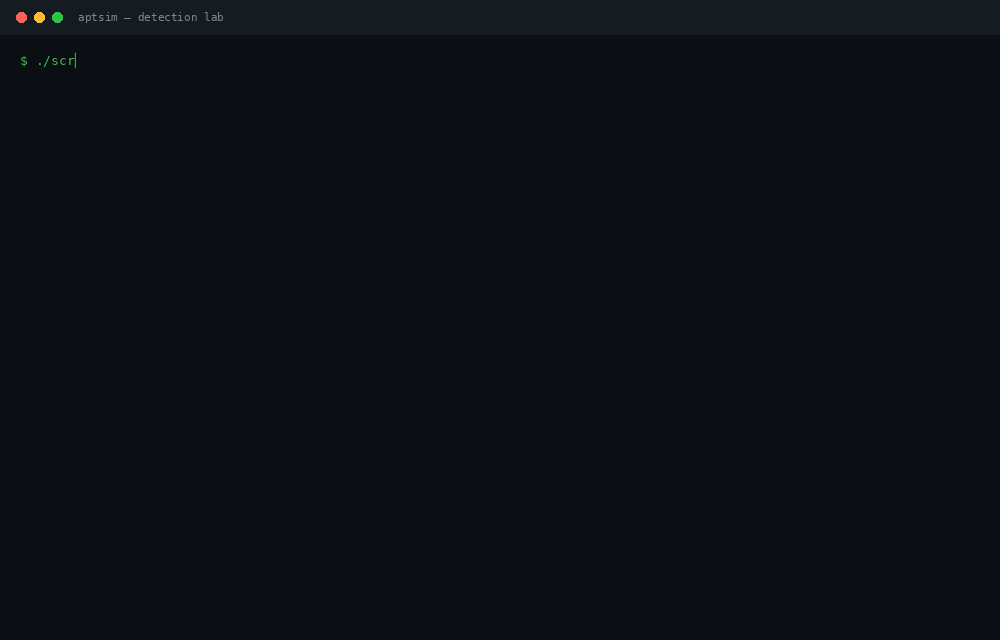
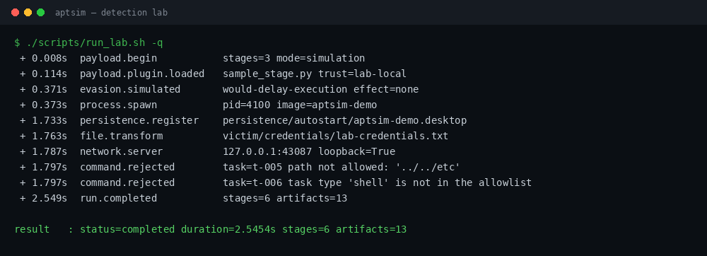
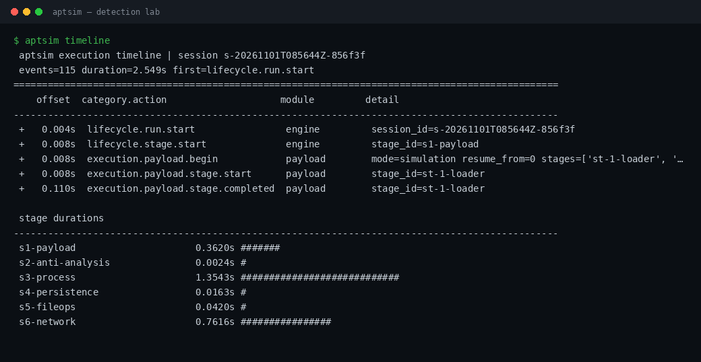
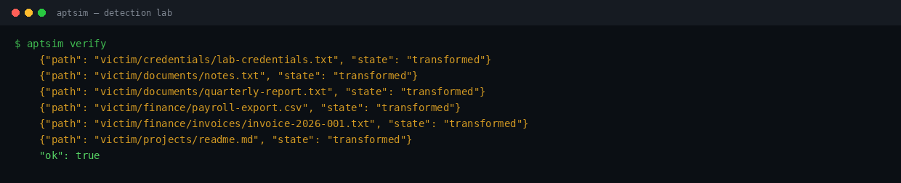
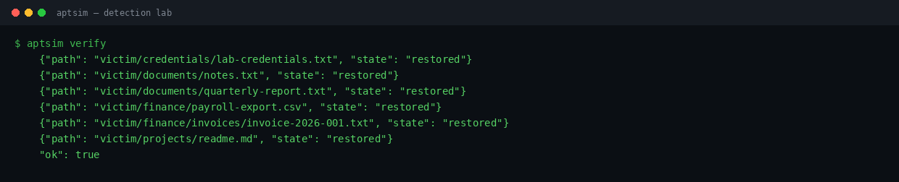
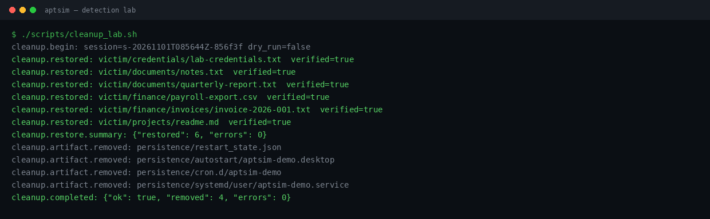
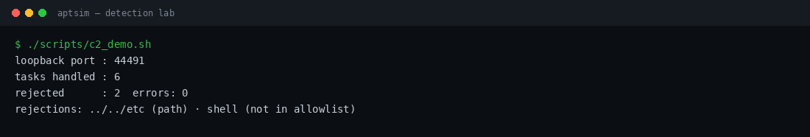
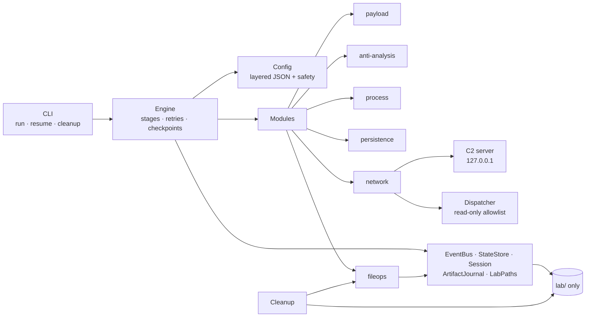

<div align="center">

# aptsim

**An APT that never attacks.**

A modular, inert malware-behaviour simulator for detection engineering.
Real telemetry. Reversible effects. Nothing leaves the lab.

[](https://www.python.org/)
[](#testing)
[](#quick-start)
[](#why-this-is-safe)
[](LICENSE)

[Quick start](#quick-start) · [What it does](#what-it-does) · [Screenshots](#screenshots) · [Commands](#command-reference) · [Safety](#why-this-is-safe) · [Architecture](docs/ARCHITECTURE.md) · [Protocol](docs/PROTOCOL.md)

</div>

---

<div align="center">
  
</div>

`aptsim` walks through the shape of an APT intrusion — staged payload, synthetic
process tree, startup artifacts, a sweep of file modifications, beaconing to a
C2 — and writes every step to an ordered JSON event log.

Then one command puts everything back.

It exists so blue teams can build and test detections against realistic attack
telemetry without touching a real sample, a real host, or a real network.

```console
$ ./scripts/run_lab.sh
[+   0.008s] lifecycle.stage.start              engine         stage_id=s1-payload
[+   0.115s] execution.payload.plugin.loaded    payload        path=.../lab/plugins/sample_stage.py
[+   0.376s] anti_analysis.evasion.simulated    anti_analysis  action=would-delay-execution effect=none
[+   0.377s] process.spawn.simulated            process        pid=4100 image=aptsim-demo args=['--resume']
[+   1.746s] persistence.registration.simulated persistence    path=persistence/autostart/aptsim-demo.desktop
[+   1.773s] file.transformed                   fileops        path=victim/documents/quarterly-report.txt
[+   1.799s] network.server.started             c2.server      host=127.0.0.1 port=38865 loopback=True
[+   1.817s] command.task.completed             network        task_id=t-006 status=rejected
[+   2.562s] lifecycle.run.completed            engine         stages=6 artifacts=13

$ aptsim verify      # every file: { "state": "transformed" }
$ aptsim cleanup     # restore, remove artifacts, verify hashes
$ aptsim verify      # every file: { "state": "restored" }, ok=true
```

---

## What it does

| Stage | Simulates | How it stays inert |
|---|---|---|
| **Payload** | 3-stage unpack, local plugin load | runs a lab-local Python plugin; records its SHA-256 |
| **Anti-analysis** | sandbox detection, delayed execution | scores **mock** indicators from config; `enforcement=log_only`, `effect=none` |
| **Process** | loader → worker → beacon chain | writes a fake PID table; no process is ever created |
| **Persistence** | XDG autostart, cron, systemd-user | renders templates under `lab/persistence`; host paths blocklisted |
| **File ops** | discovery, hashing, edits, "encryption" | reversible XOR with keys and backups retained; verified restore |
| **C2** | register, heartbeat, poll, task/result | loopback TCP, HMAC-signed, fixed scenario, read-only task allowlist |

The interesting part isn't that it looks like malware. It's that every step is
**observable, reproducible and undoable**:

- 100+ structured events per run, each with `seq`, `ts`, `t_rel`, `session_id`
- seeded randomness and configurable `time_scale` (0 for CI)
- SHA-256 baseline before mutation, manifest during, verification after
- crash injection and checkpointed resume (`--stop-after`, exit code 3)
- cleanup is journal-driven, idempotent, and refuses to touch anything unexpected

---

## Quick start

**Arch Linux** (or any Linux with Python 3.11+):

```bash
sudo pacman -S --needed python git

git clone https://github.com/Venu-exe/aptsim.git
cd aptsim
chmod +x scripts/*.sh

./scripts/setup_lab.sh     # checks environment, builds ./lab
./scripts/run_lab.sh       # full simulated intrusion
./scripts/run_tests.sh     # 73 tests
```

No `pip install` required — the scripts use `PYTHONPATH=src`. Zero third-party
runtime dependencies.

Prefer running the module directly? Set the path once:

```bash
export PYTHONPATH="$PWD/src"
python3 -m aptsim doctor
python3 -m aptsim init
python3 -m aptsim run
```

Or install it in an isolated environment:

```bash
python3 -m venv .venv && source .venv/bin/activate
python -m pip install -e .
aptsim --help
```

> Throughout this README, `aptsim <cmd>` means `python3 -m aptsim <cmd>` after
> the `export` above, or the installed `aptsim` command. The `./scripts/*.sh`
> wrappers set the path themselves.

---

## Command reference

| Command | What it does |
|---|---|
| `aptsim init` | Create the disposable lab and synthetic victim files |
| `aptsim run [-q] [--stop-after STAGE]` | Run the pipeline; stop early to demo crash/resume |
| `aptsim resume [--cleanup]` | Continue an interrupted session from its checkpoint |
| `aptsim timeline [--json]` | Ordered events + per-stage durations |
| `aptsim verify [--lenient]` | Classify files: `restored`, `transformed`, `tampered` |
| `aptsim cleanup [--dry-run]` | Restore files, remove artifacts, check baseline |
| `aptsim c2-demo` | In-process loopback client/server with the inert dispatcher |
| `aptsim c2-server` / `c2-client` | Two-terminal C2 demo (client is observe-only) |
| `aptsim doctor` | Environment and safety-lock checks |
| `aptsim list-modules` | Built-in modules + plugin contract |

### Three demos worth running

**1 — Reversible impact**

```bash
./scripts/run_lab.sh
aptsim verify            # "transformed"
aptsim cleanup
aptsim verify            # "restored", ok=true
```

**2 — Crash and recover**

```bash
aptsim run --stop-after s5-fileops    # exits 3, checkpoint written
aptsim resume --cleanup               # skips 5 completed stages
```

**3 — C2 only**

```bash
./scripts/c2_demo.sh
# tasks handled: 6   rejected: 2 (../../etc, "shell")   errors: 0
```

---

## Screenshots

| Full run | Timeline and stage durations |
|---|---|
| [](docs/assets/run.png) | [](docs/assets/timeline.png) |

| After the run: files transformed | After cleanup: files restored |
|---|---|
| [](docs/assets/verify-transformed.png) | [](docs/assets/verify-restored.png) |

| Cleanup: restore + remove artifacts | Loopback C2: 6 tasks, 2 rejected |
|---|---|
| [](docs/assets/cleanup.png) | [](docs/assets/c2-demo.png) |

All images are rendered from a real run by
[`scripts/render_assets.py`](scripts/render_assets.py); local paths are
replaced with `<LAB>`.

---

## Architecture



More in [docs/ARCHITECTURE.md](docs/ARCHITECTURE.md), plus Mermaid sources in
[`docs/diagrams/`](docs/diagrams).

---

## Why this is safe

This is the important section. The project is **not** a malware builder; the
harmful half of every technique is replaced with telemetry, not merely
"disabled".

| Guarantee | Enforced by |
|---|---|
| All writes stay inside the lab root | `LabPaths.guard`, traversal + symlink checks |
| Host persistence is impossible | path blocklist; artifacts limited to `lab/persistence` |
| No process creation or shell execution | no `subprocess`/`fork`/`exec`/`os.system` in `src/`; static-scan test |
| No `eval`/`exec` of input | not present in `src/`; plugins are local source files |
| Loopback-only networking | config validation **and** socket constructors |
| No operator control | fixed scenario; no task-injection endpoint |
| Inert commands | closed allowlist of read-only handlers; writes/shell rejected |
| Evasion never changes behaviour | mock indicators only; `log_only` enforced twice |
| "Encryption" is reversible | per-file keys kept, backups kept, restore verifies both hashes |
| Cleanup can't run wild | journal-driven; purge requires a validated path and `--yes` |

The test suite fails the build if offensive primitives are added:

```bash
grep -rnE "subprocess|os\.system|eval\(|exec\(|socket\.socket" src/ || echo clean
```

Read the full contract in [docs/SAFETY.md](docs/SAFETY.md).

> **Scope:** run this on systems you own or are authorized to test. It is a
> teaching and detection-engineering tool, not a red-team weapon.

---

## Testing

```bash
./scripts/run_tests.sh
# Ran 73 tests ... OK   (unittest + pytest, no plugins needed)
```

Covered: config layering and every safety interlock, event ordering and
thread-safe emission, path traversal and symlink escape, transform/restore
round-trips and tamper detection, dispatcher allowlist and timeouts, HMAC
signing/replay/stale frames, cleanup idempotency and integrity failure, full
pipeline, retry policies, crash/resume, and a static scan for banned
primitives.

CI runs the suite on Python 3.11, 3.12 and 3.13 on every push.

---

## Documentation

| Document | Contents |
|---|---|
| [docs/ARCHITECTURE.md](docs/ARCHITECTURE.md) | component contracts, lifecycle, data model, extension points |
| [docs/SAFETY.md](docs/SAFETY.md) | threat model, enforcement points, review checklist |
| [docs/PROTOCOL.md](docs/PROTOCOL.md) | C2 wire format, signature, limits, task schema |
| [docs/INGEST.md](docs/INGEST.md) | replay into Elastic, Splunk or Wazuh; field map; example queries |
| [docs/sample-run/](docs/sample-run) | committed run: events, timeline, manifests, before/after verify |
| [detections/](detections) | Sigma-style rules + event-to-telemetry mapping |

---

## Repository layout

```
aptsim/
├── config/            default.json · profiles · c2 scenario
├── src/aptsim/
│   ├── core/          engine, events, config, state, session, paths
│   ├── modules/       payload, process, fileops, persistence,
│   │                  anti_analysis, network, dispatcher
│   ├── c2/            protocol, server, client, scenario player
│   ├── recovery/      journal-driven cleanup
│   └── tools/         deterministic lab generator
├── tests/             73 unit + integration tests
├── scripts/           setup · run · test · cleanup · demo · replay · assets
├── docs/              architecture, safety, protocol, diagrams, assets, sample
└── detections/        Sigma rules
```

---

## Limitations

- The C2 is a deterministic scenario player, not a task queue.
- The transform is a teaching cipher (XOR keystream), not cryptography.
- Process telemetry is synthetic; no kernel or EDR hooks are exercised.
- Sandbox indicators are configuration data, not real environment probing.
- Linux/XDG-shaped artifacts only.

## License

MIT — see [LICENSE](LICENSE). Use only on systems you own or are explicitly
authorized to test. The project intentionally omits deployable offensive
capability; don't use it as a starting point for one.
